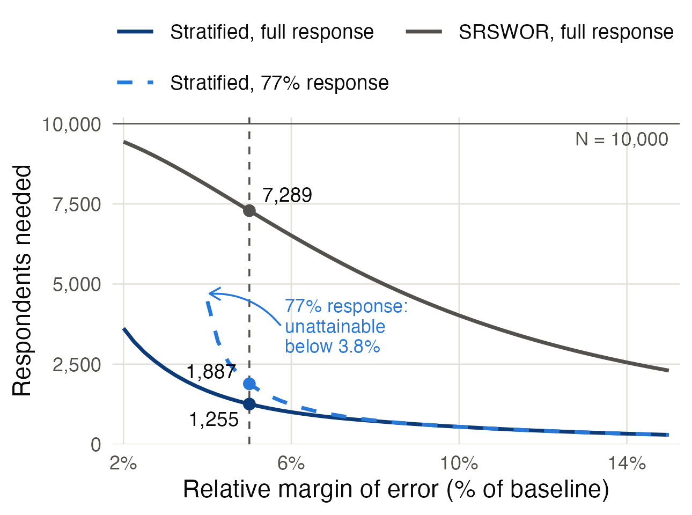

```{r setup}
knitr::opts_knit$set(root.dir = normalizePath(".."))
invisible(Sys.setlocale("LC_CTYPE", "en_US.UTF-8"))   # print Unicode (e.g. the minus sign) in any session
```

```{r load}
source("R/00_setup.R")
library(knitr)
library(kableExtra)
sp  <- read.csv(file.path(DIR_TAB, "strata_population.csv"))
op  <- read.csv(file.path(DIR_TAB, "overall_population.csv"))
pop <- read.csv(PATH_POP)
rhu <- function(x, d = 0) sign(x) * floor(abs(x) * 10^d + 0.5 + 1e-8) / 10^d   # round halves up
fd  <- function(x, d) formatC(rhu(x, d), format = "f", digits = d, big.mark = ",")
f1  <- function(x) fd(x, 1)
f2  <- function(x) fd(x, 2)
f0  <- function(x) formatC(rhu(x), format = "d", big.mark = ",")
sg  <- function(txt, x) paste0(ifelse(x > 0, "+", ifelse(x < 0, "−", "")), txt)   # signed number in text (Unicode minus)
sgt <- function(txt, x) paste0(ifelse(x > 0, "+", ifelse(x < 0, "$-$", "")), txt)       # signed number in LaTeX tables
# LaTeX tables: math allowed in cells/headers, so escape "&" and "%" by hand
ktab <- function(x, ..., escape = FALSE) kable(x, format = "latex", booktabs = TRUE, escape = escape, linesep = "", ...)
g_sp <- function(h, col) sp[[col]][sp$stratum == h]
wss  <- setNames((sp$N_h - 1) * sp$S2_h, sp$stratum)   # within-stratum sums of squares
pp   <- read.csv(file.path(DIR_TAB, "plan_prior.csv"))
pal  <- read.csv(file.path(DIR_TAB, "plan_allocation.csv"))
ps   <- read.csv(file.path(DIR_TAB, "plan_summary.csv"))
psen <- read.csv(file.path(DIR_TAB, "plan_sensitivity_at_5pct.csv"))
g_al <- function(h, col) pal[[col]][pal$stratum == h]
rp   <- round(100 * RESP_PLAN)
ss   <- read.csv(file.path(DIR_TAB, "sample_summary.csv"))
smp  <- read.csv(PATH_SAMPLE)
g_ss <- function(h, col) ss[[col]][ss$stratum == h]
es   <- read.csv(file.path(DIR_TAB, "estimates.csv"))
ec   <- read.csv(file.path(DIR_TAB, "estimates_compare.csv"))
eh   <- read.csv(file.path(DIR_TAB, "estimates_by_stratum.csv"))
ex   <- read.csv(file.path(DIR_TAB, "estimates_extra.csv"))
sims <- read.csv(file.path(DIR_TAB, "sim_summary.csv"))
tp   <- read.csv(file.path(DIR_TAB, "sim_true_plan.csv"))
sa   <- read.csv(file.path(DIR_TAB, "sim_assurance.csv"))
pin  <- read.csv(file.path(DIR_TAB, "plan_prior_inflation.csv"))
mnar <- read.csv(file.path(DIR_TAB, "sim_mnar.csv"))                     # row 1: half the response odds, row 2: twice
n_ass <- function(p) round(min(sa$issued[sa$meets_expansion >= p]), -2)   # issued size meeting the bound in a share p of samples
zst  <- with(merge(eh, sp[, c("stratum", "S_h")], by = "stratum"),       # stratum means' gaps in true SEs
             abs(ybar - T_true / N_h) / sqrt((1 - r_h / N_h) * S_h^2 / r_h))
e_st <- es[es$method == "Stratified, adjusted weights", ]
e_sr <- es[es$method == "SRSWOR benchmark", ]
e_ra <- es[es$method == "Stratified, ratio estimator", ]
g_red <- 1 - (sims$emp_se[sims$design == "Stratified, ratio"] / sims$emp_se[sims$design == "Stratified (Neyman)"])^2   # variance cut by the ratio estimator
g_eh <- function(h, col) eh[[col]][eh$stratum == h]
g_sim <- function(d, col) sims[[col]][sims$design == d]
```

# Abstract {.unnumbered}

National surveys of honey bee colony losses rely mostly on self-selected samples, whose accuracy cannot be quantified. This study designs and evaluates a probability survey of total colony losses over winter 2025/26 by the `r f0(N)` registered beekeepers of a hypothetical country, with a 95% confidence interval (CI) whose half-width is at most 5% of a baseline value. All data are simulated, calibrated to the COLOSS survey of winter 2019/20. Beekeepers are stratified by operation size with Neyman allocation, the `r f0(g_al("COM","N_h"))` commercial operations are taken in full, and the total is estimated with a ratio estimator using the register's colony counts. Planned for a `r rp`% response rate, with the expansion estimator's larger variance as a safety margin, the survey needs `r f0(ps$n_strat_resp)` respondents from `r f0(ps$issued_strat)` issued beekeepers, whereas simple random sampling without replacement (SRSWOR) would need `r f0(ps$n_srs_full)` respondents even with full response. One simulated survey estimates that `r f0(e_ra$estimate)` colonies were lost, `r f1(100*e_ra$estimate/ex$M)`% of colonies going into winter, against a true total of `r f0(ex$T_true)`. Over `r f0(g_sim("SRSWOR","reps"))` repeated samples the estimator is essentially unbiased, meets the 5% bound in `r f0(100*g_sim("Stratified, ratio","meets_5pct"))`% of samples and covers the true total in `r f1(100*g_sim("Stratified, ratio","coverage"))`%, against `r f1(100*g_sim("SRSWOR","coverage"))`% for SRSWOR. Without the colony counts, the expansion estimator meets the bound in only `r f0(100*g_sim("Stratified (Neyman)","meets_5pct"))`% of samples, as the prior understated commercial variability. The commercial response rate is the main risk: below `r f0(100*ps$R_min_com)`% on the planning values, no sample size reaches the target. Stratification by operation size with a take-all commercial stratum and ratio estimation is an efficient basis for national colony-loss surveys.

*Keywords:* stratified random sampling; Neyman allocation; take-all stratum; ratio estimation; non-response weighting; Monte Carlo simulation; honey bee colony losses

# Introduction and Motivation {#sec-intro}

## Background (A2) {#sec-background}

Honey bees produce honey and play a critical role as pollinators of crops and natural vegetation (Pirk et al., 2014). The COLOSS (Prevention of honey bee COlony LOSSes) network runs international monitoring of colony losses with a standardised questionnaire, so that results can be compared across countries (Gray et al., 2023; van der Zee et al., 2013). The 30,491 beekeepers outside New Zealand in the COLOSS survey of winter 2019/20 lost 18.1% of their colonies, with national loss rates from 7.4% to 36.5% (Gray et al., 2023). A reliable national total shows how much honey production and pollination capacity is lost each winter, and helps beekeepers' associations and veterinary services to target support and disease control.

## Statement of the problem {#sec-problem}

This project designs a sample survey to estimate how many honey bee colonies the registered beekeepers of a hypothetical country lost over winter 2025/26, from 1 October 2025 to 31 March 2026. The country takes part in the COLOSS monitoring and uses its case definitions and questionnaire. Unlike the self-selected samples common in colony-loss monitoring (@sec-lit), however, the survey must be a probability sample: its design must differ from simple random sampling, its 95% confidence interval (CI) must have a half-width of at most 5% of a baseline value (@sec-baseline), and simple random sampling without replacement (SRSWOR) serves as the benchmark.

## Aim and objectives (A1) {#sec-aims}

The aim is to design, draw and analyse a stratified sample that meets this requirement, and to evaluate the design by simulation, through four questions:

* How many colonies did registered beekeepers lose in total over winter 2025/26, and what share of the colonies going into winter was lost?
* How are the losses spread across hobby, side-line and commercial operations?
* How many beekeepers must be sampled, and how should they be allocated across strata, to meet the precision requirement once non-response is allowed for?
* Does stratification by operation size with Neyman allocation reach the required precision with far fewer respondents than SRSWOR, and are its CIs valid in repeated sampling?

@sec-methods reviews the literature and sets out the methods, @sec-results presents the results, and @sec-conclusion draws conclusions and makes recommendations.

# Review of Methods {#sec-methods}

## Literature review {#sec-lit}

### Colony-loss surveys {#sec-lit-surveys}

Colony-loss surveys agree on how losses are measured but differ in the period they cover and in how they group operations. The COLOSS network reports the loss rate as the share of colonies going into winter that were lost, with confidence intervals from quasi-binomial models that allow for extra-binomial variation between operations (Gray et al., 2020, 2023; van der Zee et al., 2013). Its questionnaire covers the northern-hemisphere winter, so Pirk et al. (2014) modified it for the southern hemisphere, and Nganso et al. (2025) applied it to the active beekeeping season in nine Sub-Saharan African countries. The United States survey of vanEngelsdorp et al. (2008) grouped operations into 1–50, 51–499 and 500 or more colonies, against the COLOSS classes of up to 50, 51–150 and more than 150, so loss rates by operation size cannot be compared directly across surveys.

The findings agree on operation size but not on migration: in the COLOSS surveys, operations with more than 150 colonies in winter 2018/19, and with more than 50 colonies in winter 2019/20, had significantly lower loss rates than smaller ones, a difference both reports link to management (Gray et al., 2020, 2023). The United States survey, by contrast, found no difference in loss by operation size (vanEngelsdorp et al., 2008). Beekeepers who migrated their colonies lost more than those who did not in winter 2018/19 (Gray et al., 2020) and in South Africa (Pirk et al., 2014), but less in winter 2019/20 (Gray et al., 2023), and Gray et al. (2020) note that the migration effect varies from year to year and between countries.

The surveys rely largely on non-probability samples, with each COLOSS country organising its own means of contacting beekeepers, many now mostly or only through online surveys (Gray et al., 2023). The South African survey was a survey of convenience with snowball recruitment, answered by about 4% of registered beekeepers (Pirk et al., 2014); in the United States, apiary inspectors telephoned beekeepers they felt were representative of their state's industry (vanEngelsdorp et al., 2008); and the respondents in Africa made up less than 1% of the beekeepers in the nine countries (Nganso et al., 2025). Van der Zee et al. (2013) urge a shift from self-selected samples towards at least simple random sampling, as a random sample gives results whose accuracy can be quantified, and report response rates from 7.5%, for an open invitation in a national beekeeping journal, to 77% where beekeepers were contacted personally.

### Sampling methods {#sec-lit-methods}

Neyman (1934) showed that, for a fixed total sample size, the variance of the stratified estimator is smallest when the sample in each stratum is proportional to the stratum size times the stratum SD, $N_hS_h$, and that the SDs can be estimated beforehand from a preliminary enquiry. Neyman allocation is commonly used when the cost per unit is constant and the stratum variances differ substantially, as in skewed populations, which can be stratified with a certainty (take-all) stratum of the largest units, in which every unit is examined (Gunning et al., 2008). For non-response, most surveys inflate the weights within weighting classes by the inverse of the class response rate (Brick, 2013). This removes the bias if every unit in a class has the same probability of responding, the missing-at-random (MAR) assumption (Brick, 2013; Kalton & Flores-Cervantes, 2003), and works best when the classes are related to both response and the survey variables (Kalton, 1983, as cited in Brick, 2013). Brick (2013) also notes that response rates may not predict non-response bias; in this study the response rate matters mainly for precision in the take-all stratum (@sec-fpc).

## Target population and parameter (A2–A4) {#sec-target}

For beekeeper $i$, let $m_i$ be the number of colonies going into winter on 1 October 2025 and $y_i$ the number of those colonies lost by 31 March 2026, the COLOSS winter period (Nganso et al., 2025). Following the COLOSS case definition (van der Zee et al., 2013), a colony counts as lost when:

* it no longer has any living bees, for example because it died or absconded;
* its population became too small for normal activities such as brood rearing and foraging; or
* it had queen problems that could not be solved, such as a drone-laying queen.

The definition also counts colonies lost to theft, fire, flooding or similar causes unrelated to health. These losses are excluded here, as in the COLOSS analysis of operation size, because they are largely beyond the beekeeper's control (Gray et al., 2023). The primary parameter is the total number of colonies lost,
$$
T=\sum_{i=1}^{N}y_i,\qquad N=10{,}000.
$$

The target population is the `r f0(N)` beekeepers on the national register who had at least one colony going into winter on 1 October 2025. Unregistered beekeepers fall outside it, so $T$ refers to registered beekeepers only. They are described by two institutional characteristics, registration and operation-size class (hobby, side-line or commercial), by their number of colonies and by migratory practice, a management practice with a geographic side, as migrating beekeepers move their colonies between sites; region is not modelled (@sec-simpop). Van der Zee et al. (2013) name registers held through beekeeping associations, census registers and veterinary services as possible sampling frames for colony-loss surveys, while noting that few countries have a representative list. The register here is assumed to record each beekeeper's contact details and number of colonies as at 1 October 2025, so $M=\sum_i m_i$ is known and the loss rate $T/M$ follows from $T$. Personal characteristics such as age or beekeeping experience are assumed not to be recorded, so they cannot serve as stratifiers; Table \ref{tab:tconcepts} separates the population concepts that follow from these choices.

```{r tconcepts}
defs <- data.frame(
  Concept = c("Target population", "Sampling frame", "Sampled population", "Sampling unit", "Observation unit"),
  Definition = c(
    "The 10,000 registered beekeepers, about whom conclusions are drawn.",
    "The national register of beekeepers, with contact details and number of colonies.",
    "Eligible registered beekeepers who can be contacted (beekeepers with out-of-date contact details are missed).",
    "The registered beekeeper (one beekeeping operation); element sampling, no clusters.",
    "The beekeeper's whole operation, for which colonies and losses are reported, as in the COLOSS survey (Gray et al., 2023)."))
ktab(defs, escape = TRUE, caption = "Key population concepts.") |>
  kable_styling(latex_options = "HOLD_position", font_size = 8) |>
  column_spec(1, width = "3.2cm", bold = TRUE) |> column_spec(2, width = "12.6cm")
```

## Notation {#sec-notation}

Strata $h=1,2,3$ are hobby operations (HOB, up to 50 colonies), side-line operations (SID, 51 to 150) and commercial operations (COM, more than 150), the size classes of Gray et al. (2023) with the names used by van der Zee et al. (2013). $N_h$ is the number of beekeepers in stratum $h$ ($\sum_h N_h=N$), $W_h=N_h/N$ its stratum weight and $M_h$ its number of colonies. $\bar Y_h$, $S_h$ and $S_h^2$ are the stratum mean, standard deviation (SD) and variance of $y_i$, and $T_h=N_h\bar Y_h$ is the stratum total; $\bar Y=T/N$ and $S^2$ are the population mean and variance. $n_h$ is the planned number of respondents in stratum $h$ (@sec-ss-results), $n=\sum_h n_h$, $n_h^*$ the number of beekeepers issued and $r_h$ the number who responded. Lowercase letters ($\bar y_h$, $s_h^2$) denote sample values, and $\bar y_{st}=\sum_h W_h\bar y_h$ is the stratified sample mean.

## Simulated finite population (A5) {#sec-simpop}

The country is hypothetical, so its population is calibrated to the COLOSS survey of winter 2019/20 (Gray et al., 2023): the split of beekeepers and colonies across operation sizes, the loss rate of each size class and the share of beekeepers who migrate all come from that survey (Appendix A). Region is not modelled, as the calibration uses COLOSS results pooled over 36 countries.

Each beekeeper's number of colonies $m_i$ is drawn from a distribution over their size class with mean `r f1(coloss$mean_colonies[1])`, `r f1(coloss$mean_colonies[2])` or `r f1(coloss$mean_colonies[3])` colonies, the class means computed from the numbers of colonies and beekeepers reported by Gray et al. (2023). That survey gives no distribution within the size classes, so the shapes are assumptions: the numbers of hobby and side-line operations fall geometrically with size, and commercial operations follow a long-tailed lognormal distribution, capped at 5,000 colonies, that allows for a few very large operations. Each beekeeper migrates with probability `r fd(P_MIGRATORY, 3)`, since 81.7% of COLOSS beekeepers did not migrate their colonies (Gray et al., 2023; Appendix A). That survey does not report migration by operation size, so the two are assumed unrelated.

Each beekeeper's loss risk $p_i$ follows a Beta distribution whose mean is the COLOSS loss rate of their size class, `r f1(100*coloss$loss_rate[1])`%, `r f1(100*coloss$loss_rate[2])`% or `r f1(100*coloss$loss_rate[3])`% (Gray et al., 2023), with SD `r LOSS_SD` (an assumption), and $y_i\sim\text{Binomial}(m_i,p_i)$, all drawn in `R/01_population.R` with `set.seed(4102)`. This beta-binomial model suits loss counts: each colony either survives the winter or is lost, and losses vary more between operations than a binomial model allows, which is why COLOSS analyses use quasi-binomial models (@sec-lit-surveys). Migration is left out of the loss model: its effect was significant in winter 2019/20 (15.2% for migrants against 16.1%, $p<0.001$; Gray et al., 2023), but its direction changes between years and countries (@sec-lit-surveys).

## Choice of design (A6) {#sec-design}

The primary design is stratified random sampling by operation size, with an independent SRSWOR in each stratum and Neyman allocation, $n_h\propto N_hS_h$. Neyman allocation can ask for more beekeepers than a stratum contains: with the planning values it would assign `r f0(ps$n_com_first)` respondents to the commercial stratum, which has only `r f0(g_al("COM","N_h"))` beekeepers (@sec-ss-results). That stratum is therefore taken in full (a take-all stratum), and the rest of the sample is shared among the other strata; every stratum keeps at least `r MIN_NH` respondents. Van der Zee et al. (2013) recommend stratified sampling for colony-loss surveys, name operation size as one basis for the strata so that hobby and commercial operations are both covered, and report Neyman allocation in the Scottish surveys of 2008 (in a modified form) and 2011.

* Population structure: losses per beekeeper differ sharply between operation-size groups although the loss rates are similar (@sec-data), as colony counts are extremely skewed, a few large operations holding a large share of the colonies and losses (@fig-shares). Stratifying by operation size separates these groups and puts the few large operations in a stratum of their own. The boundaries are the COLOSS size classes, the only ones with published loss rates. Splitting a class on colony counts would improve efficiency further: under the planning model, a split of the hobby class at `r ps$split_hob` colonies cuts the respondents needed from `r f0(ps$n_strat_full)` to `r f0(ps$n_split_hob)`, and such boundaries can be optimised with the Lavallée and Hidiroglou algorithm (Gunning et al., 2008). The design keeps the COLOSS classes and uses the colony counts, which drive the differences in losses, in a ratio estimator instead (@sec-estdesign).
* Efficiency and precision: the estimated total $\hat T=N\bar y_{st}$ has variance $N^2V(\bar y_{st})$, which Neyman allocation minimises (@sec-lit-methods) by sampling most where $N_hS_h$ is largest. Under full response the take-all stratum then contributes no variance; non-response brings part of it back.
* Cost: operation size is already on the register for every beekeeper, so stratifying needs no extra data collection. Every stratum uses the same questionnaire and interview modes, so the cost per interview $c_h$ is assumed equal across strata, and the cost-optimal allocation $n_h\propto N_hS_h/\sqrt{c_h}$ then reduces to Neyman allocation.
* Operational convenience: selection is a separate SRSWOR within each stratum of the size-sorted register, done in one step with standard software (@sec-selection).
* Alternatives: cluster sampling would raise the variance, systematic sampling gives only implicit stratification, and selection with probability proportional to colony counts would take every commercial operation with certainty anyway, as the take-all stratum does.

The design is not self-weighting, so the analysis must use the design weights defined in @sec-selection.

## Selection and data collection (A7) {#sec-selection}

The register is cleaned (duplicates and beekeepers with no colonies removed) and sorted by stratum. The planned $n_h$ (@sec-ss-results) are inflated for the anticipated response rate to give the issued $n_h^*$. An SRSWOR of $n_h^*$ beekeepers is drawn in each stratum with `sampling::strata()`, so each beekeeper has inclusion probability $\pi_{hi}=n_h^*/N_h$ and design weight $d_{hi}=1/\pi_{hi}$. After fieldwork the weights are adjusted within each stratum to $w_{hi}=N_h/r_h$, the weighting-class adjustment of @sec-lit-methods with the strata as classes.

The survey would use the COLOSS standardised questionnaire (van der Zee et al., 2013), which records colonies going into winter, those lost by cause and whether colonies were migrated (Gray et al., 2023). The questionnaire would be pretested, and selected beekeepers then invited by e-mail and SMS to complete it online, with two reminders and computer-assisted telephone interviewing (CATI) for those who do not reply. Fieldwork would run in April and May 2026, straight after the winter, in line with the annual COLOSS spring survey (Gray et al., 2023), with consent under the country's data-protection law; in this project it is simulated (@sec-sample-selection).

## Sources of non-sampling error (A8) {#sec-nse}

The main sources of non-sampling error are coverage error (duplicate entries, registered beekeepers who no longer keep bees, outdated contact details or colony counts), non-response, response error (recall error, ambiguous cases such as merged or split colonies) and processing error (data-entry errors); Table \ref{tab:tnse} in Appendix B gives their likely effects on $\hat T$ and their mitigation. The design-based SEs of Sections -@sec-estimation-results and -@sec-simulation-results do not measure them. The simulation assumes that the register covers the target population exactly and that non-response is random within strata; non-response related to the losses themselves would leave bias after weighting (@sec-compare).

## Sample-size formula (B1) {#sec-formula}

With an SRSWOR of $n_h$ respondents in each stratum, $\hat T=\sum_h N_h\bar y_h$ has variance
$$
V(\hat T)=\sum_h N_h^2\left(1-\frac{n_h}{N_h}\right)\frac{S_h^2}{n_h}.
$$
The 95% CI has half-width $z\sqrt{V(\hat T)}$ with $z=1.96$, so a half-width of at most $e\,T_0$, where $e=0.05$ and $T_0$ is the baseline value, requires ${V(\hat T)\le V_0=(e\,T_0/z)^2}$. Under Neyman allocation, ${n_h=n\,N_hS_h/\sum_k N_kS_k}$, the smallest total sample size
$$
n=\frac{\left(\sum_h N_hS_h\right)^2}{V_0+\sum_h N_hS_h^2},
$$
where the term $\sum_h N_hS_h^2$ comes from the finite population correction. With a take-all stratum (@sec-design), the formula is applied to the remaining strata. For the SRSWOR benchmark, $n=n_0/(1+n_0/N)$ with $n_0=(zNS/(e\,T_0))^2$, where $S$ is the SD of colonies lost across all beekeepers. For the primary estimator, the ratio estimator of @sec-estdesign, the same formulas apply approximately with $S_h$ replaced by the smaller SD $S_{eh}$ of the residuals about the colony counts; the plan uses $S_h$, which gives it a safety margin.

## Estimation and simulation design (D1, E1, E2) {#sec-estdesign}

The respondents are analysed with the R `survey` package (Lumley, 2004), using a design object with the three strata, no clusters, the adjusted weights $w_{hi}=N_h/r_h$ and the finite population correction from $N_h$; the code is in Appendix C. The respondents in each stratum are thus treated as an SRSWOR of $r_h$ from $N_h$, which holds when non-response is random within strata (@sec-fpc).

The register also gives every beekeeper's colonies $m_i$ and the stratum totals $M_h$. The primary estimator, the separate ratio estimator $\hat T_R=\sum_h M_h\bar y_h/\bar m_h$ with $\bar m_h$ the respondents' mean number of colonies, uses them and is computed with `svyratio()`. Its approximate variance has the form of $V(\hat T)$ with $S_h^2$ replaced by the variance of the residuals $y_i-R_hm_i$, where $R_h=T_h/M_h$, so it gains when losses rise roughly in proportion to colony counts. Planning the sample size with the larger variance of the expansion estimator $\hat T$ gives $\hat T_R$ a safety margin (@sec-final), and $\hat T$ is reported alongside it for comparison.

`R/05_simulation.R` repeats the complete procedure `r f0(g_sim("SRSWOR","reps"))` times on the fixed population, with `set.seed(1021)`. Each repetition draws a new stratified sample of `r f0(g_ss("HOB","issued"))`, `r f0(g_ss("SID","issued"))` and `r f0(g_ss("COM","issued"))` beekeepers, simulates `r rp`% response within strata, and computes $\hat T$ and $\hat T_R$, their estimated SEs and their 95% CI limits with the closed forms that `svytotal()` and `svyratio()` use (checked against them in `R/04_estimation.R`). Each repetition also draws an SRSWOR of `r f0(sum(ss$issued))` beekeepers with the same response process. The estimates, SEs and CI limits from all `r f0(2*g_sim("SRSWOR","reps"))` samples are saved in `output/tables/sim_reps.csv`. Following Morris et al. (2019), each estimator is assessed by its bias, empirical SE, average estimated SE, root mean squared error (RMSE), CI coverage and average CI width, with Monte Carlo SEs for the bias and the coverage; the Monte Carlo SE of an estimated coverage $\hat p$ is $\sqrt{\hat p(1-\hat p)/R}$ for $R$ repetitions.

# Analysis and Results {#sec-results}

## Data description (A5) {#sec-data}

The population lost $T=$ `r f0(op$T)` colonies out of $M=$ `r f0(op$M)`, a total loss of `r f1(op$total_loss_pct)`%, close to the COLOSS loss rate of 15.6% excluding natural disasters (11.1% dead or empty plus 4.5% with queen problems; Gray et al., 2023). The planner knows neither these values nor those in Table \ref{tab:tstrata}, and instead uses the COLOSS loss rates by size class and the register's colony counts (@sec-baseline).

```{r tstrata}
t2 <- sp |>
  transmute(Stratum = stratum, `$N_h$` = f0(N_h), `$W_h$` = fd(W_h, 3), `$M_h$` = f0(M_h),
            `$\\bar Y_h$` = f2(Ybar_h), `$S_h$` = f2(S_h), `$S_h^2$` = f1(S2_h), `$T_h$` = f0(T_h),
            `Sim.` = paste0(f1(total_loss_pct), "\\%"), `COLOSS` = paste0(f1(coloss_loss_pct), "\\%"))
t2 <- rbind(t2, data.frame(Stratum = "Population", `$N_h$` = f0(N), `$W_h$` = "1.000", `$M_h$` = f0(op$M),
  `$\\bar Y_h$` = f2(op$Ybar), `$S_h$` = f2(op$S), `$S_h^2$` = f1(op$S2), `$T_h$` = f0(op$T),
  `Sim.` = paste0(f1(op$total_loss_pct), "\\%"), `COLOSS` = "15.6\\%", check.names = FALSE))
ktab(t2, align = "lrrrrrrrrr",
     caption = "True stratum parameters, unknown to the planner. $\\bar Y_h$, $S_h$, $S_h^2$ and $T_h$ refer to $y_i$, colonies lost per beekeeper; the loss rate is $T_h/M_h$, with the COLOSS rate of each class from Gray et al. (2023).") |>
  kable_styling(latex_options = c("HOLD_position", "scale_down"), font_size = 8) |>
  add_header_above(c(" " = 8, "Loss rate" = 2)) |>
  row_spec(3, hline_after = TRUE) |> row_spec(4, bold = TRUE)
```

{#fig-shares width="50%" fig-align="center" fig-pos="!htb"}

The strata differ sharply (Table \ref{tab:tstrata}, @fig-shares): commercial operations are only `r f1(g_sp("COM","share_beekeepers"))`% of beekeepers but hold `r f0(g_sp("COM","share_colonies"))`% of the colonies and `r f0(g_sp("COM","share_lost"))`% of the colonies lost. Mean losses are `r f2(g_sp("HOB","Ybar_h"))`, `r f2(g_sp("SID","Ybar_h"))` and `r f2(g_sp("COM","Ybar_h"))` colonies per beekeeper, and the between-stratum share of the variance is $\eta^2=1-\sum_h(N_h-1)S_h^2/[(N-1)S^2]=$ `r f1(100*op$eta2)`%. Within strata, hobby operations are far more homogeneous than the population as a whole (SD `r f2(g_sp("HOB","S_h"))` colonies, against `r f2(op$S)` overall) and side-line operations somewhat more so (SD `r f2(g_sp("SID","S_h"))`). Commercial operations remain highly variable (SD `r f2(g_sp("COM","S_h"))`) and hold `r f0(100*wss["COM"]/sum(wss))`% of the within-stratum variation, which adds sampling variance only through non-response, as the stratum is taken in full (@sec-fpc).

## Sample size and allocation (B2–B10) {#sec-ss-results}

### Baseline and minimum sample size (B2, B3) {#sec-baseline}

The planner knows each beekeeper's colonies $m_i$ from the register and the COLOSS loss rate $p_h$ of each size class (Gray et al., 2023), so the baseline is $T_0=\sum_h p_hM_h=$ `r f0(ps$T0)` colonies and the target half-width of the 95% CI is `r f0(ps$halfwidth)` colonies. The true total, unknown to the planner, is `r f0(op$T)` colonies (@sec-data), so the baseline overstates it by only `r f1(100*(ps$T0/op$T-1))`%: the population was simulated with the same COLOSS loss rates, and the gap is chance variation in the simulated losses. The prior stratum SDs come from the beta-binomial model of @sec-simpop with the same assumed risk SD of `r LOSS_SD`: each beekeeper has $E(y_i)=p_hm_i$ and $V(y_i)=m_ip_h(1-p_h)+m_i(m_i-1)\,0.15^2$, and $S_h^2$ is the variance of $E(y_i)$ within the stratum plus the mean of $V(y_i)$. This gives $S_h=$ `r f2(g_al("HOB","S_h_prior"))`, `r f2(g_al("SID","S_h_prior"))` and `r f2(g_al("COM","S_h_prior"))` colonies, against true values of `r f2(g_sp("HOB","S_h"))`, `r f2(g_sp("SID","S_h"))` and `r f2(g_sp("COM","S_h"))` (Table \ref{tab:tstrata}), so even with the generating model, a best case that a real planner would not have, the planner underestimates the commercial SD by about `r f0(100*(1-g_al("COM","S_h_prior")/g_sp("COM","S_h")))`%. For the ratio estimator the same model gives residual SDs of $S_{eh}=$ `r f2(g_al("HOB","Se_h_prior"))`, `r f2(g_al("SID","Se_h_prior"))` and `r f2(g_al("COM","Se_h_prior"))`, and with full response Neyman allocation, rounded up in each stratum, needs at least $n=$ `r f0(ps$n_ratio_full)` respondents, the minimum for the primary estimator. The plan keeps the expansion estimator's larger requirement of `r f0(ps$n_strat_full)` respondents, all `r f0(g_al("COM","n_full"))` commercial, `r f0(g_al("HOB","n_full"))` hobby and `r f0(g_al("SID","n_full"))` side-line beekeepers, as a safety margin (@sec-final).

### Finite population correction, design effect and non-response (B4) {#sec-fpc}

Without the finite population correction and the take-all rule, Neyman allocation would need $n_{0,\text{st}}=$ `r f0(ceiling(ps$n0_strat))` respondents; together they cut this to `r f0(ps$n_strat_full)`. For SRSWOR, with the planner's overall SD of `r f2(ps$S_all_prior)` colonies from the same model, $n_0=$ `r f0(ceiling(ps$n0_srs))` exceeds $N$, and the correction reduces it to `r f0(ps$n_srs_full)`. Beekeepers are sampled individually, not in clusters, so no intracluster correlation enters the design effect: at `r f0(ps$n_strat_full)` respondents, the expansion estimator has `r fd(ps$deff_plan, 3)` times the variance of SRSWOR.

The planned response rate is `r rp`%, the highest of the rates reviewed in @sec-lit-surveys, reached with personal contact, which the telephone follow-up of @sec-selection provides here; applying this rate is still an assumption, and non-response is assumed random within strata. The commercial stratum cannot be topped up: about `r f0(g_al("COM","n_resp"))` of its `r f0(g_al("COM","N_h"))` beekeepers respond, and the variance left in that stratum, $N_h^2(1-r_h/N_h)S_h^2/r_h$ with $r_h=$ `r f0(g_al("COM","n_resp"))` respondents, uses `r f0(100*ps$share_V0_takeall)`% of $V_0$; below a commercial response rate of `r f0(100*ps$R_min_com)`% (`r f0(100*ps$R_min_com_ratio)`% for the ratio estimator) it would exceed $V_0$, so no sample size could reach the target. The hobby and side-line strata make up for it with `r f0(g_al("HOB","n_resp"))` and `r f0(g_al("SID","n_resp"))` respondents instead of `r f0(g_al("HOB","n_full"))` and `r f0(g_al("SID","n_full"))`, for `r f0(ps$n_strat_resp)` respondents in all. Dividing each stratum's respondents by `r RESP_PLAN` and rounding up gives `r f0(ps$issued_strat)` beekeepers to issue.

### Allocation across strata (B5) {#sec-alloc}

Hobby operations have the largest share of $\sum_h N_hS_h$, so they receive the most respondents, at a sampling fraction of `r f0(100*g_al("HOB","frac_issued"))`%; commercial operations have almost as large a share from only `r f0(g_al("COM","N_h"))` beekeepers, so that stratum is taken in full, and side-line operations are sampled at `r f0(100*g_al("SID","frac_issued"))`% (Table \ref{tab:talloc}).

```{r talloc}
t4 <- data.frame(Stratum = pal$stratum, `$N_h$` = f0(pal$N_h), `Prior $S_h$` = f2(pal$S_h_prior),
                 `Share of $\\sum N_hS_h$` = paste0(f1(100 * pal$NS_share), "\\%"),
                 `Full response` = f0(pal$n_full), `RR` = f0(pal$n_resp),
                 `Issued $n_h^*$` = f0(pal$issued), `$n_h^*/N_h$` = paste0(f1(100 * pal$frac_issued), "\\%"),
                 check.names = FALSE)
names(t4)[6] <- paste0(rp, "\\% response")
t4 <- rbind(t4, data.frame(Stratum = "Total", `$N_h$` = f0(N), `Prior $S_h$` = "", `Share of $\\sum N_hS_h$` = "100.0\\%",
                           `Full response` = f0(sum(pal$n_full)), `RR` = f0(sum(pal$n_resp)),
                           `Issued $n_h^*$` = f0(sum(pal$issued)), `$n_h^*/N_h$` = paste0(f1(100 * sum(pal$issued) / N), "\\%"),
                           check.names = FALSE, row.names = NULL) |> setNames(names(t4)))
ktab(t4, align = "lrrrrrrr",
     caption = paste0("Neyman allocation with a take-all commercial stratum, for a 95\\% CI half-width of 5\\% of the baseline. Respondents $n_h$ are shown under full response and under the planned ", rp, "\\% response rate; the issued sample is $n_h^*=n_h/", RESP_PLAN, "$, rounded up.")) |>
  kable_styling(latex_options = c("hold_position"), font_size = 8) |>    # may float, so no gap is left before it
  add_header_above(c(" " = 4, "Respondents $n_h$" = 2, " " = 2), escape = FALSE) |>
  row_spec(3, hline_after = TRUE) |> row_spec(4, bold = TRUE)
```

### Sample size against the margin of error (B6, B7) {#sec-margin}

@fig-margin plots the respondents needed against the relative margin of error: stratified sampling needs far fewer than SRSWOR at every margin. With `r rp`% response the curve rises steeply as the margin narrows, and no sample size reaches margins below `r f1(100*ps$rel_min_resp)`%, where non-response alone uses up the variance budget even if every beekeeper is issued. @fig-sens repeats the calculation for assumed values of $T$ equal to 25%, 50%, 75% and 100% of the baseline, with full response (solid lines) and `r rp`% response (dashed).

::: {layout="[[47,-6,47]]" fig-pos="H"}

{#fig-margin}

{#fig-sens}

:::

### Quantities held fixed and discussion (B8–B10) {#sec-fixed}

@fig-sens holds fixed the population size $N$ and the $N_h$, the prior $S_h$, the 95% confidence level, Neyman allocation with the take-all and minimum rules, the finite population correction and, for each set of curves, the response rate. Only the assumed value of $T$, $\theta T_0$ with $\theta=0.25,0.5,0.75,1$, changes, and with it the target half-width $e\,\theta T_0$. The analysis for proportions (B9) does not apply: for a total the requirement depends on $S_h$ relative to $T_0$ rather than on $P(1-P)$, so it has no maximum at $P=0.5$ and instead grows as the assumed total falls.

A smaller assumed total with the same stratum SDs means a smaller absolute half-width, and so a larger sample. At a 5% margin the requirement grows from `r f0(psen$n[psen$theta == 1])` respondents at the baseline to `r f0(psen$n[psen$theta == 0.75])`, `r f0(psen$n[psen$theta == 0.5])` and `r f0(psen$n[psen$theta == 0.25])` at 75%, 50% and 25% of it, and at 50% and 25% the side-line stratum is taken in full as well. A lower total would in practice come with smaller SDs, so these figures are conservative. At `r rp`% response the 5% margin is out of reach once $T$ is 75% of the baseline or less, as even issuing every beekeeper would give margins of at least `r fd(100*psen$rel_min_resp[psen$theta == 0.75], 2)`%, `r fd(100*psen$rel_min_resp[psen$theta == 0.5], 2)`% and `r fd(100*psen$rel_min_resp[psen$theta == 0.25], 2)`%. Prior SDs `r f0(100*(pin$inflation[1]-1))`% or `r f0(100*(pin$inflation[2]-1))`% higher would raise the requirement at `r rp`% response to `r f0(pin$n_resp[1])` or `r f0(pin$n_resp[2])` respondents, and the minimum commercial response rate from `r f0(100*ps$R_min_com)`% to `r f0(100*pin$R_min_com[1])`% or `r f0(100*pin$R_min_com[2])`%. The design matters as much as the assumed value: at the baseline, proportional allocation ($n_h\propto N_h$) would need `r f0(ps$n_prop_full)` respondents and SRSWOR `r f0(ps$n_srs_full)`, in line with $V_{\text{opt}}\le V_{\text{prop}}\le V_{\text{SRS}}$. Neyman allocation gains so much because the stratum SDs differ widely: it samples the variable strata heavily and the homogeneous hobby stratum lightly.

## Sample selection (C1–C6) {#sec-sample-selection}

### Final sample size (C1) {#sec-final}

The final sample issues `r f0(sum(ss$issued))` beekeepers, `r f1(100*sum(ss$issued)/N)`% of the register: `r f0(g_ss("HOB","issued"))` hobby, `r f0(g_ss("SID","issued"))` side-line and all `r f0(g_ss("COM","issued"))` commercial beekeepers (Table \ref{tab:talloc}). This is the Neyman-allocated sample expected to give the expansion estimator a 95% CI half-width of at most 5% of the baseline once the planned `r rp`% response rate is allowed for (@sec-fpc), and it should yield `r f0(ps$n_strat_resp)` respondents, including about `r f0(g_ss("COM","planned_resp"))` commercial beekeepers. For the ratio estimator, the minimum at `r rp`% response is only `r f0(ps$n_ratio_resp)` respondents (@sec-baseline), so the sample carries a safety margin of `r f0(100*(ps$n_strat_resp/ps$n_ratio_resp-1))`% more respondents: it meets the bound on the true SE even if the prior residual SDs are `r f0(100*ps$ratio_margin_sd)`% too small, and allows for the estimated SE varying between samples (@sec-bound).

### Selection and realised sample (C3, C5) {#sec-draw}

`R/03_sample.R` sorts the register by stratum and draws an independent SRSWOR of $n_h^*$ beekeepers in each stratum with `sampling::strata()`, using `set.seed(2026)`; the core of the procedure is listed in Appendix C. Fieldwork is then simulated: each issued beekeeper responds with probability `r RESP_PLAN`, independently within strata, and answers are kept only for respondents. The draw gave `r f0(sum(ss$respondents))` respondents, a response rate of `r f1(100*sum(ss$respondents)/sum(ss$issued))`%, with at least the planned number in every stratum (Table \ref{tab:tsample}).

```{r tsample}
t5 <- data.frame(Stratum = ss$stratum, `$N_h$` = f0(ss$N_h), `Issued $n_h^*$` = f0(ss$issued),
                 `$\\pi_{hi}$` = fd(ss$incl_prob, 3), `$d_{hi}$` = fd(ss$design_weight, 3),
                 `Planned` = f0(ss$planned_resp), `Actual $r_h$` = f0(ss$respondents),
                 `Response rate` = paste0(f1(100 * ss$resp_rate), "\\%"), `$w_{hi}=N_h/r_h$` = fd(ss$weight, 3),
                 check.names = FALSE)
t5 <- rbind(t5, setNames(data.frame("Total", f0(N), f0(sum(ss$issued)), "", "", f0(sum(ss$planned_resp)),
                                    f0(sum(ss$respondents)),
                                    paste0(f1(100 * sum(ss$respondents) / sum(ss$issued)), "\\%"), ""), names(t5)))
ktab(t5, align = "lrrrrrrrr",
     caption = "The realised sample: issued sample, inclusion probabilities $\\pi_{hi}=n_h^*/N_h$, design weights $d_{hi}=1/\\pi_{hi}$, planned and actual respondents, and the non-response-adjusted weights $w_{hi}=N_h/r_h$.") |>
  kable_styling(latex_options = c("HOLD_position"), font_size = 8) |>
  add_header_above(c(" " = 5, "Respondents" = 3, " " = 1)) |>
  row_spec(3, hline_after = TRUE) |> row_spec(4, bold = TRUE)
```

Every beekeeper on the register belongs to exactly one stratum and has a known, positive inclusion probability: `r fd(g_ss("HOB","incl_prob"), 3)` in the hobby stratum, `r fd(g_ss("SID","incl_prob"), 3)` in the side-line stratum and 1 in the commercial stratum. Over the register the probabilities sum to `r f0(sum(ss$incl_prob*ss$N_h))`, the issued sample size, and the code checks that the issued sample's design weights and the respondents' adjusted weights each sum to $N=$ `r f0(N)`.

### Data files (C2, C4, C6) {#sec-files}

The population and the sample are saved as CSV files, and `data/population.csv`, generated by `R/01_population.R` (@sec-simpop), holds one row for each of the `r f0(N)` beekeepers with a beekeeper identifier, the stratum and operation-size class, migratory practice, colonies going into winter $m_i$, colonies lost $y_i$ and the loss percentage. `data/sample.csv` holds one row for each of the `r f0(nrow(smp))` issued beekeepers, with the identifier, the stratum and operation-size class, the register's colonies $m_i$ (an auxiliary variable), $N_h$ and $n_h^*$, the inclusion probability $\pi_{hi}$, the design weight $d_{hi}$, a response flag, $r_h$, the adjusted weight $w_{hi}$, migratory practice and the outcome $y_i$. The last three are filled in for the `r f0(sum(smp$responded))` respondents and left blank for the `r f0(sum(smp$responded == 0))` non-respondents, whose answers were not obtained.

## Estimation (D2–D8) {#sec-estimation-results}

### Estimate of the total (D2, D3) {#sec-total}

The ratio estimator gives an estimated total of $\hat T_R=$ `r f0(e_ra$estimate)` colonies lost, a loss rate of $\hat T_R/M=$ `r f1(100*e_ra$estimate/ex$M)`%, with estimated variance `r f0(e_ra$variance)`, SE `r f0(e_ra$se)` and 95% CI from `r f0(e_ra$lcl)` to `r f0(e_ra$ucl)` colonies (Table \ref{tab:tests}). The coefficient of variation (CV) is `r f1(100*e_ra$cv)`%, and the design effect, the ratio of this variance to that of SRSWOR with the same number of respondents, is `r fd(e_ra$deff, 3)`. Hobby, side-line and commercial operations account for `r f0(g_eh("HOB","T_R"))`, `r f0(g_eh("SID","T_R"))` and `r f0(g_eh("COM","T_R"))` colonies, or `r f0(100*g_eh("HOB","T_R")/e_ra$estimate)`%, `r f0(100*g_eh("SID","T_R")/e_ra$estimate)`% and `r f0(100*g_eh("COM","T_R")/e_ra$estimate)`% of the losses. The expansion estimator gives $\hat T=$ `r f0(e_st$estimate)` with SE `r f0(e_st$se)` and design effect `r fd(e_st$deff, 3)` (`r fd(ps$deff_plan, 3)` was expected at the planning stage, @sec-fpc), so the register's colony counts cut the SE by `r f0(100*(1-e_ra$se/e_st$se))`%.

```{r tests}
fmt_ci <- function(l, u) paste0(f0(l), "--", f0(u))
t6 <- data.frame(
  Estimator = c("Naive, $N\\bar y$", "Design weights $d_{hi}$ only",
                "Expansion $\\hat T$, weights $w_{hi}$", "Ratio estimator $\\hat T_R$", "SRSWOR benchmark", "True total $T$"),
  Estimate = f0(c(ec$estimate[1:3], e_ra$estimate, e_sr$estimate, ex$T_true)),
  Error = c(sgt(paste0(f1(abs(ec$error_pct[1:3])), "\\%"), ec$error_pct[1:3]),
            sgt(paste0(f1(abs(e_ra$error_pct)), "\\%"), e_ra$error_pct),
            sgt(paste0(f1(abs(e_sr$error_pct)), "\\%"), e_sr$error_pct), ""),
  SE = c("", "", f0(e_st$se), f0(e_ra$se), f0(e_sr$se), ""),
  `95\\% CI` = c("", "", fmt_ci(e_st$lcl, e_st$ucl), fmt_ci(e_ra$lcl, e_ra$ucl), fmt_ci(e_sr$lcl, e_sr$ucl), ""),
  CV = c("", "", paste0(f1(100 * e_st$cv), "\\%"), paste0(f1(100 * e_ra$cv), "\\%"), paste0(f1(100 * e_sr$cv), "\\%"), ""),
  Deff = c("", "", fd(e_st$deff, 3), fd(e_ra$deff, 3), fd(e_sr$deff, 3), ""),
  Respondents = c(rep(f0(e_st$n_resp), 4), f0(e_sr$n_resp), ""),
  check.names = FALSE)
ktab(t6, align = "lrrrrrrr",
     caption = "Estimates of the total colonies lost from the realised sample, with the expansion estimator and the ratio estimator (bold, the primary estimator), and from the SRSWOR benchmark, against the true total. The error is relative to $T$.") |>
  kable_styling(latex_options = c("HOLD_position", "scale_down"), font_size = 8) |>
  row_spec(2, hline_after = TRUE) |> row_spec(4, bold = TRUE) |> row_spec(5, hline_after = TRUE)
```

### Inclusion probabilities and weights (D4) {#sec-weights}

Each beekeeper's inclusion probability is $\pi_{hi}=n_h^*/N_h$, with the values in Table \ref{tab:tsample}. Its inverse, the design weight $d_{hi}$, is the number of register beekeepers that each issued beekeeper represents: `r fd(g_ss("HOB","design_weight"), 2)` hobby, `r fd(g_ss("SID","design_weight"), 2)` side-line or 1 commercial beekeeper. Non-response leaves $r_h$ respondents in each stratum, so the weights are multiplied by $n_h^*/r_h$, giving $w_{hi}=N_h/r_h=$ `r fd(g_ss("HOB","weight"), 2)`, `r fd(g_ss("SID","weight"), 2)` and `r fd(g_ss("COM","weight"), 2)`; even a commercial respondent, selected with certainty, stands in for the commercial beekeepers who did not respond. The ratio estimator multiplies these weights by $M_h/\hat X_h$, where $\hat X_h=\sum_i w_{hi}m_i$ is the respondents' weighted colony count, so that it matches the register's $M_h$; the factors are `r fd(g_eh("HOB","T_R")/g_eh("HOB","T_hat"), 3)`, `r fd(g_eh("SID","T_R")/g_eh("SID","T_hat"), 3)` and `r fd(g_eh("COM","T_R")/g_eh("COM","T_hat"), 3)`. Within each stratum the adjusted weights sum to $N_h$, so the respondents represent the whole register.

### Naive, design-adjusted and true values (D5) {#sec-naive}

Ignoring the design, $N$ times the unweighted mean of the respondents gives `r f0(ec$estimate[1])` colonies, `r f0(ec$error_pct[1])`% too high: commercial operations are `r f1(100*g_eh("COM","r_h")/e_st$n_resp)`% of the respondents but only `r f1(100*g_sp("COM","W_h"))`% of the register. The design weights alone give `r f0(ec$estimate[2])`, `r f1(abs(ec$error_pct[2]))`% too low, because the weight of the `r f0(sum(smp$responded == 0))` non-respondents is lost; the adjusted weights pass that weight to the respondents in the same stratum and give an estimate `r f1(abs(ec$error_pct[3]))`% below the true total of `r f0(ex$T_true)`, and the ratio estimator one `r f1(abs(e_ra$error_pct))`% below.

### SRSWOR benchmark (D6) {#sec-bench}

An SRSWOR of `r f0(nrow(smp))` beekeepers, the same issued size, drawn with `set.seed(2027)` and subject to the same `r rp`% response, gave `r f0(e_sr$n_resp)` respondents and an estimate of `r f0(e_sr$estimate)` with SE `r f0(e_sr$se)` (Table \ref{tab:tests}). With almost the same number of respondents, its variance is `r f1(e_sr$variance/e_ra$variance)` times that of the ratio estimator and its CI is `r f1(e_sr$se/e_ra$se)` times as wide.

### Empirical and estimated standard errors (D7) {#sec-se}

Over the `r f0(g_sim("SRSWOR","reps"))` repetitions of @sec-simulation-results, the ratio estimator has an empirical SE of `r f0(g_sim("Stratified, ratio","emp_se"))` against an average estimated SE of `r f0(g_sim("Stratified, ratio","avg_se"))`, so its variance estimator is accurate, as is the expansion estimator's (empirical `r f0(g_sim("Stratified (Neyman)","emp_se"))`, average estimated `r f0(g_sim("Stratified (Neyman)","avg_se"))`); for SRSWOR the average estimated SE of `r f0(g_sim("SRSWOR","avg_se"))` is `r f0(100*(1-g_sim("SRSWOR","avg_se")/g_sim("SRSWOR","emp_se")))`% below the empirical `r f0(g_sim("SRSWOR","emp_se"))`. The expansion estimator's realised SE of `r f0(e_st$se)` is below its theoretical value of `r f0(ex$se_theory)`, computed from the true $S_h$ for the realised $r_h$: the sample variances came out low in all three strata.

### Precision bound and the effect of the design (D8) {#sec-bound}

The ratio estimator's realised half-width is `r f0(e_ra$halfwidth)` colonies, `r f1(100*e_ra$rel_half_T0)`% of the baseline, so this sample meets the 5% bound, as it does with the expansion estimator (`r f1(100*e_st$rel_half_T0)`%). Both CIs nevertheless miss the true total, as a 95% CI should in about one sample in 20: the respondents' losses came out low in all three strata, the stratum means by `r f1(min(zst))` to `r f1(max(zst))` SEs (computed from the true $S_h$). Over repeated samples the ratio estimator meets the bound in `r f0(100*g_sim("Stratified, ratio","meets_5pct"))`% of samples and the expansion estimator in only `r f0(100*g_sim("Stratified (Neyman)","meets_5pct"))`%, with an average half-width of `r f1(100*g_sim("Stratified (Neyman)","avg_width")/2/ex$T0)`% of the baseline. The formula of @sec-formula bounds the true SE, a bound the estimated half-width meets about half the time even under a correct plan: a plan with the true SDs (`r f0(ex$n_true_plan)` respondents) meets it with the expansion estimator in `r f0(100*tp$meets_5pct)`% of samples (`R/05_simulation.R`), and the lower `r f0(100*g_sim("Stratified (Neyman)","meets_5pct"))`% reflects the prior, which underestimated the commercial SD (@sec-baseline). Meeting the bound in 80% or 90% of samples thus needs a margin, which for the expansion estimator would mean issuing about `r f0(n_ass(0.8))` or `r f0(n_ass(0.9))` beekeepers rather than `r f0(sum(ss$issued))`; the ratio estimator gets it from the planned sample (@sec-final). The design is what makes the bound reachable at all: stratification and the colony counts cut the variance to `r fd(e_ra$deff, 3)` times that of SRSWOR, which never meets the bound with this many respondents.

## Simulation study (E3–E5) {#sec-simulation-results}

### Performance measures (E3, E4) {#sec-perf}

Against the true total $T=$ `r f0(ex$T_true)` (Table \ref{tab:tsim}), all three estimators are essentially unbiased: the biases of `r sg(f0(abs(g_sim("Stratified, ratio","bias"))), rhu(g_sim("Stratified, ratio","bias")))` colonies for the ratio estimator, `r sg(f0(abs(g_sim("Stratified (Neyman)","bias"))), rhu(g_sim("Stratified (Neyman)","bias")))` for the expansion estimator and `r sg(f0(abs(g_sim("SRSWOR","bias"))), rhu(g_sim("SRSWOR","bias")))` for SRSWOR are `r f1(abs(g_sim("Stratified, ratio","bias"))/g_sim("Stratified, ratio","mc_se_bias"))`, `r f1(abs(g_sim("Stratified (Neyman)","bias"))/g_sim("Stratified (Neyman)","mc_se_bias"))` and `r f1(abs(g_sim("SRSWOR","bias"))/g_sim("SRSWOR","mc_se_bias"))` Monte Carlo SEs from zero. With $R=$ `r f0(g_sim("SRSWOR","reps"))`, the ratio estimator's CIs cover $T$ in `r f1(100*g_sim("Stratified, ratio","coverage"))`% of repetitions (Monte Carlo SE `r f1(100*g_sim("Stratified, ratio","mc_se_coverage"))` percentage points), within Monte Carlo error of the nominal 95% (`r f1((0.95-g_sim("Stratified, ratio","coverage"))/g_sim("Stratified, ratio","mc_se_coverage"))` SE below). The expansion estimator's cover it in `r f1(100*g_sim("Stratified (Neyman)","coverage"))`%, slightly but significantly below 95% (`r f1((0.95-g_sim("Stratified (Neyman)","coverage"))/g_sim("Stratified (Neyman)","mc_se_coverage"))` Monte Carlo SEs), and SRSWOR's in only `r f1(100*g_sim("SRSWOR","coverage"))`% (SE `r f1(100*g_sim("SRSWOR","mc_se_coverage"))`). The expansion estimator and SRSWOR miss mostly on the low side, in `r f0(g_sim("Stratified (Neyman)","miss_low"))` of `r f0(g_sim("Stratified (Neyman)","miss_low")+g_sim("Stratified (Neyman)","miss_high"))` and `r f0(g_sim("SRSWOR","miss_low"))` of `r f0(g_sim("SRSWOR","miss_low")+g_sim("SRSWOR","miss_high"))` misses. Samples that happen to contain fewer of the large commercial operations give low estimates together with low estimated SEs (correlations `r f2(g_sim("Stratified (Neyman)","cor_est_se"))` and `r f2(g_sim("SRSWOR","cor_est_se"))`), so their CIs are too narrow on the low side; the take-all stratum removes most of this effect, the rest coming mainly from its non-respondents. The ratio estimator weakens the link further (correlation `r f2(g_sim("Stratified, ratio","cor_est_se"))`) and its misses are less lopsided (`r f0(g_sim("Stratified, ratio","miss_low"))` of `r f0(g_sim("Stratified, ratio","miss_low")+g_sim("Stratified, ratio","miss_high"))` low), which brings its coverage closer to 95%.

```{r tsim}
st_ <- sims[sims$design == "Stratified (Neyman)", ]; ra_ <- sims[sims$design == "Stratified, ratio", ]
sr_ <- sims[sims$design == "SRSWOR", ]
pct <- function(x, d = 1) paste0(fd(100 * x, d), "\\%")
both <- function(f) c(f(ra_), f(st_), f(sr_))
t7 <- data.frame(
  Measure = c("Bias (Monte Carlo SE)", "Relative bias", "Empirical SE",
              "Average estimated SE", "RMSE", "Coverage of the 95\\% CI (Monte Carlo SE)",
              "Average CI width", "Design effect (variance ratio)", "Samples meeting the 5\\% bound", "Average respondents",
              "Relative bias if response depends on losses"),
  rbind(both(function(d) paste0(sgt(f0(abs(d$bias)), rhu(d$bias)), " (", f0(d$mc_se_bias), ")")),
        both(function(d) sgt(pct(abs(d$rel_bias), 2), rhu(100 * d$rel_bias, 2))),
        both(function(d) f0(d$emp_se)), both(function(d) f0(d$avg_se)),
        both(function(d) f0(d$rmse)),
        both(function(d) paste0(pct(d$coverage), " (", fd(100 * d$mc_se_coverage, 1), ")")),
        both(function(d) f0(d$avg_width)), both(function(d) fd(d$emp_deff, 3)),
        both(function(d) pct(d$meets_5pct)), both(function(d) f0(d$avg_resp)),
        sapply(c("rel_bias_ratio", "rel_bias_exp", "rel_bias_srs"), function(k)          # MNAR rows of sim_mnar.csv
          paste(sapply(mnar[[k]], function(x) sgt(pct(abs(x)), rhu(100 * x, 1))), collapse = " / "))))
names(t7) <- c("Measure", "Ratio $\\hat T_R$", "Expansion $\\hat T$", "SRSWOR")
ktab(t7, align = "lrrr",
     caption = paste0("Performance of the stratified design, with the ratio and expansion estimators, and of SRSWOR over ", f0(st_$reps), " repetitions, against the true total $T=", f0(ex$T_true), "$. Monte Carlo SEs of the bias and of the coverage (in percentage points) are in brackets. The last row repeats the simulation (2,000 repetitions each) with half / twice the response odds for a beekeeper who lost half their colonies (Section \\ref{sec-compare}).")) |>
  kable_styling(latex_options = c("hold_position"), font_size = 8) |>    # may float, so no gap is left before it
  add_header_above(c(" " = 1, "Stratified (Neyman)" = 2, " " = 1)) |>
  column_spec(1, width = "6.5cm")
```

### Comparison with SRSWOR (E5) {#sec-compare}

With the same average of `r f0(g_sim("Stratified, ratio","avg_resp"))` respondents, the stratified design with the ratio estimator has `r fd(g_sim("Stratified, ratio","emp_deff"), 3)` times the empirical variance of SRSWOR (the empirical design effect), an RMSE of `r f0(g_sim("Stratified, ratio","rmse"))` against `r f0(g_sim("SRSWOR","rmse"))`, and CIs about a quarter as wide on average (`r f0(g_sim("Stratified, ratio","avg_width"))` against `r f0(g_sim("SRSWOR","avg_width"))` colonies), with better coverage. Its variance is `r f0(100*g_red)`% below that of the expansion estimator, which has `r fd(g_sim("Stratified (Neyman)","emp_deff"), 3)` times the variance of SRSWOR. The SRSWOR estimator uses a single adjustment $N/r$; post-stratifying it by size class would give about the precision of proportional allocation, which needs `r f0(ps$n_prop_full)` respondents against `r f0(ps$n_srs_full)` (@sec-fixed), so the stratified design gains mainly through Neyman allocation and the take-all stratum, not through weighting within strata. @fig-sim shows how tightly the ratio estimator clusters around $T$ compared with SRSWOR. These results assume that non-response is random within strata. If response depends on the losses, which Gray et al. (2020) report can happen in either direction, the weighting cannot remove the bias: when a beekeeper who lost half their colonies has half or twice the response odds of one who lost none, the ratio estimator is off by `r sg(paste0(f1(abs(100*mnar$rel_bias_ratio[1])), "%"), mnar$rel_bias_ratio[1])` or `r sg(paste0(f1(abs(100*mnar$rel_bias_ratio[2])), "%"), mnar$rel_bias_ratio[2])` and its CIs cover $T$ in only `r f0(100*mnar$cover_ratio[1])`% or `r f0(100*mnar$cover_ratio[2])`% of samples, against `r f0(100*mnar$cover_srs[1])`% or `r f0(100*mnar$cover_srs[2])`% for SRSWOR, whose wider CIs absorb more of the bias (Table \ref{tab:tsim}).

{#fig-sim width="54%" fig-align="center" fig-pos="H"}

# Conclusion and Recommendations {#sec-conclusion}

## Summary and conclusion {#sec-summary}

In contrast to the surveys reviewed in @sec-lit, the design developed here gives every registered beekeeper a known, positive inclusion probability, so its estimates carry design-based SEs. The survey estimates that registered beekeepers lost `r f0(e_ra$estimate)` colonies over winter 2025/26 (95% CI `r f0(e_ra$lcl)` to `r f0(e_ra$ucl)`), `r f1(100*e_ra$estimate/ex$M)`% of the colonies going into winter. Commercial operations, only `r f1(100*g_sp("COM","W_h"))`% of beekeepers, account for `r f0(100*g_eh("COM","T_R")/e_ra$estimate)`% of the estimated losses, hobby operations for `r f0(100*g_eh("HOB","T_R")/e_ra$estimate)`% and side-line operations for `r f0(100*g_eh("SID","T_R")/e_ra$estimate)`%. The CI narrowly misses the true total of `r f0(ex$T_true)`, as a 95% CI does in about one sample in 20.

Allowing for `r rp`% response, the survey needs `r f0(ps$n_strat_resp)` respondents from `r f0(ps$issued_strat)` issued beekeepers: `r f0(g_al("HOB","issued"))` hobby, `r f0(g_al("SID","issued"))` side-line and all `r f0(g_al("COM","issued"))` commercial beekeepers, planned with the expansion estimator's larger variance as a safety margin for the ratio estimator. Stratification by operation size with Neyman allocation is far more efficient than SRSWOR: at full response it needs `r f0(ps$n_strat_full)` respondents against `r f0(ps$n_srs_full)` for the same precision, and over `r f0(g_sim("SRSWOR","reps"))` repetitions the ratio estimator's variance is `r fd(g_sim("Stratified, ratio","emp_deff"), 3)` times that of SRSWOR. The ratio estimator meets the 5% bound in `r f0(100*g_sim("Stratified, ratio","meets_5pct"))`% of samples, and its CIs cover the true total in `r f1(100*g_sim("Stratified, ratio","coverage"))`%, against `r f1(100*g_sim("SRSWOR","coverage"))`% for SRSWOR. Without the colony counts, the expansion estimator meets the bound in only `r f0(100*g_sim("Stratified (Neyman)","meets_5pct"))`% of samples, because the prior understated the commercial SD.

## Limitations {#sec-limits}

The results apply to the registered beekeepers of a simulated population: the distributions of colonies within the size classes, the loss-risk SD of `r LOSS_SD` and the independence of migration and operation size are assumptions, and the calibration pools 36 countries, so regional differences are not represented (@sec-simpop). Fieldwork is simulated with response at random within strata, so the weighting removes non-response bias by construction; if response depends on the losses, the estimates are off by about `r f0(100*min(abs(mnar$rel_bias_ratio)))`–`r f0(100*max(abs(mnar$rel_bias_ratio)))`% and their CIs undercover badly (@sec-compare). The plan also depends on prior SDs, here from the generating model itself, as the COLOSS reports cited give no between-operation SD of loss risk; they understated the commercial SD (@sec-bound), and understating all of them by `r f0(100*(pin$inflation[1]-1))`% would almost double the sample needed (@sec-fixed).

## Recommendations for further work {#sec-further}

A real survey should keep the ratio estimator and a safety margin in the plan, as here; the expansion estimator alone would need about `r f0(n_ass(0.9))` issued beekeepers to meet the bound in 90% of samples, and finer strata on colony counts (@sec-design) would cut the sample further. The response rate in the take-all commercial stratum is the main risk: below `r f0(100*ps$R_min_com)`% on the planning values no sample size reaches the target, so intensive follow-up of the `r f0(g_al("COM","N_h"))` commercial operations matters more than a larger sample of hobby beekeepers. A short non-response follow-up asking only for colonies lost would test the MAR assumption, on which the estimates depend (@sec-compare).

# References {.unnumbered}

Brick, J. M. (2013). Unit nonresponse and weighting adjustments: A critical review. *Journal of Official Statistics*, *29*(3), 329--353. <https://doi.org/10.2478/jos-2013-0026>

Gray, A., Adjlane, N., Arab, A., Ballis, A., Brusbardis, V., Bugeja Douglas, A., Cadahía, L., Charrière, J.-D., Chlebo, R., Coffey, M. F., Cornelissen, B., Amaro da Costa, C., Danneels, E., Danihlík, J., Dobrescu, C., Evans, G., Fedoriak, M., Forsythe, I., Gregorc, A., . . . Brodschneider, R. (2023). Honey bee colony loss rates in 37 countries using the COLOSS survey for winter 2019--2020: The combined effects of operation size, migration and queen replacement. *Journal of Apicultural Research*, *62*(2), 204--210. <https://doi.org/10.1080/00218839.2022.2113329>

Gray, A., Adjlane, N., Arab, A., Ballis, A., Brusbardis, V., Charrière, J.-D., Chlebo, R., Coffey, M. F., Cornelissen, B., Amaro da Costa, C., Dahle, B., Danihlík, J., Dražić, M. M., Evans, G., Fedoriak, M., Forsythe, I., Gajda, A., de Graaf, D. C., Gregorc, A., . . . Brodschneider, R. (2020). Honey bee colony winter loss rates for 35 countries participating in the COLOSS survey for winter 2018--2019, and the effects of a new queen on the risk of colony winter loss. *Journal of Apicultural Research*, *59*(5), 744--751. <https://doi.org/10.1080/00218839.2020.1797272>

Gunning, P., Horgan, J. M., & Keogh, G. (2008). An implementation strategy for efficient convergence of the Lavallée and Hidiroglou stratification algorithm. *Journal of Official Statistics*, *24*(2), 213--228.

Kalton, G., & Flores-Cervantes, I. (2003). Weighting methods. *Journal of Official Statistics*, *19*(2), 81--97.

Lumley, T. (2004). Analysis of complex survey samples. *Journal of Statistical Software*, *9*(8), 1--19. <https://doi.org/10.18637/jss.v009.i08>

Morris, T. P., White, I. R., & Crowther, M. J. (2019). Using simulation studies to evaluate statistical methods. *Statistics in Medicine*, *38*(11), 2074--2102. <https://doi.org/10.1002/sim.8086>

Neyman, J. (1934). On the two different aspects of the representative method: The method of stratified sampling and the method of purposive selection. *Journal of the Royal Statistical Society*, *97*(4), 558--625. <https://doi.org/10.2307/2342192>

Nganso, B. T., Ayalew, W., Wubie, A. J., Assefa, F., Belayhun, L., Ndungu, N. N., Toroitich, D., Otieno-Ayayo, Z. N., Wambua, M. B., Oyieyo, Y. O., Elie, N., Sikirou, R., Idrissou, S. B., Mwiza, W., Turner, S., Bobadoye, B. O., Fameni, S. T., Gaboe, S., Agbodzavu, M. K., . . . Subramanian, S. (2025). Honey bee colony losses and causes during the active beekeeping season 2022/2023 in nine Sub-Saharan African countries. *PLoS One*, *20*(5), e0322489. <https://doi.org/10.1371/journal.pone.0322489>

Pirk, C. W. W., Human, H., Crewe, R. M., & vanEngelsdorp, D. (2014). A survey of managed honey bee colony losses in the Republic of South Africa – 2009 to 2011. *Journal of Apicultural Research*, *53*(1), 35--42. <https://doi.org/10.3896/IBRA.1.53.1.03>

van der Zee, R., Gray, A., Holzmann, C., Pisa, L., Brodschneider, R., Chlebo, R., Coffey, M. F., Kence, A., Kristiansen, P., Mutinelli, F., Nguyen, B. K., Adjlane, N., Peterson, M., Soroker, V., Topolska, G., Vejsnæs, F., & Wilkins, S. (2013). Standard survey methods for estimating colony losses and explanatory risk factors in *Apis mellifera*. *Journal of Apicultural Research*, *52*(4), 1--36. <https://doi.org/10.3896/IBRA.1.52.4.18>

vanEngelsdorp, D., Hayes, J., Jr., Underwood, R. M., & Pettis, J. (2008). A survey of honey bee colony losses in the U.S., fall 2007 to spring 2008. *PLoS ONE*, *3*(12), e4071. <https://doi.org/10.1371/journal.pone.0004071>

\newpage

# Appendix A — Calibration of the simulated population {.unnumbered}

```{=latex}
\setcounter{table}{0}
\renewcommand{\thetable}{A\arabic{table}}
```

```{r tcalib}
t1 <- sp |>
  transmute(Stratum = paste0(sub(" \\(.*", "", operation), " (", stratum, "), ", c("up to 50", "51--150", "more than 150"), " colonies"),
            `$N_h$` = f0(N_h), `$W_h$` = fd(W_h, 3),
            `Sim.` = f1(mean_colonies), `COLOSS` = f1(coloss_mean_colonies),
            `Colonies $M_h$` = f0(M_h),
            `Sim. ` = paste0(f1(share_colonies), "\\%"), `COLOSS ` = paste0(f1(coloss_pct_colonies), "\\%"),
            `Migratory` = paste0(f1(pct_migratory), "\\%"))
t1 <- rbind(t1, data.frame(Stratum = "Total", `$N_h$` = f0(N), `$W_h$` = "1.000",
  `Sim.` = f1(op$M / N), `COLOSS` = f1(sum(coloss$colonies) / COLOSS_N_BEEKEEPERS),
  `Colonies $M_h$` = f0(op$M), `Sim. ` = "100.0\\%", `COLOSS ` = "100.0\\%",
  `Migratory` = paste0(f1(op$pct_migratory), "\\%"), check.names = FALSE))
ktab(t1, align = "lrrrrrrrr",
     caption = "Composition of the simulated population by operation size, compared with the COLOSS survey of winter 2019/20 (Gray et al., 2023). The COLOSS mean colonies and shares of colonies are computed from the numbers of beekeepers and colonies in each class reported there. The stratum weights $W_h$ equal the COLOSS shares of beekeepers (90.2\\%, 6.6\\% and 3.2\\%). In the COLOSS survey 81.7\\% of beekeepers did not migrate their colonies, so the simulated migration probability of 0.183 slightly overstates migration: the remaining 18.3\\% includes 163 beekeepers who answered that they did not know.") |>
  kable_styling(latex_options = c("HOLD_position", "scale_down"), font_size = 8) |>
  add_header_above(c(" " = 3, "Mean colonies" = 2, " " = 1, "Share of colonies" = 2, " " = 1)) |>
  row_spec(3, hline_after = TRUE) |> row_spec(4, bold = TRUE)
```

# Appendix B — Sources of non-sampling error {.unnumbered}

```{=latex}
\setcounter{table}{0}
\renewcommand{\thetable}{B\arabic{table}}
```

```{r tnse}
nse <- data.frame(
  Source = c("Coverage", "Non-response", "Response", "Processing"),
  Cause = c(
    "Duplicate entries; registered beekeepers who no longer keep bees; outdated contact details or colony counts",
    "Selected beekeepers who cannot be reached, decline or do not reply",
    "Recall error in colony counts; ambiguous cases such as weak, merged or split colonies",
    "Data-entry errors, such as more colonies lost than held"),
  `Likely effect on $\\hat T$` = c(
    "Duplicates inflate some selection chances; ineligible beekeepers reduce the effective sample; uncontactable ones are equivalent to non-respondents; wrong strata lower efficiency",
    "Bias in either direction if non-respondents' losses differ systematically from respondents'",
    "Measurement error in $y_i$ and $m_i$",
    "Wrong values for a few beekeepers"),
  Mitigation = c(
    "Removal of duplicates; eligibility question; colony count asked again",
    "Reminders; CATI follow-up; incentives; weighting within strata (Section \\ref{sec-selection})",
    "Fixed reference dates; COLOSS case definitions; trained interviewers; pretest",
    "Range checks ($0\\le y_i\\le m_i$); checks against the register"),
  check.names = FALSE)
rr <- function(w) paste0(">{\\\\raggedright\\\\arraybackslash}p{", w, "}")   # doubled: column_spec substitutes via regex
kable(nse, format = "latex", booktabs = TRUE, escape = FALSE, linesep = "\\addlinespace",
      caption = "Main sources of non-sampling error.") |>
  kable_styling(latex_options = "HOLD_position", font_size = 8) |>
  column_spec(1, bold = TRUE, latex_column_spec = rr("2.1cm")) |>
  column_spec(2, latex_column_spec = rr("5.0cm")) |>
  column_spec(3, latex_column_spec = rr("4.9cm")) |>
  column_spec(4, latex_column_spec = rr("4.5cm"))
```

\newpage

# Appendix C — Selection and estimation code {.unnumbered}

The core of the selection procedure in `R/03_sample.R` (Section \ref{sec-draw}) draws an independent SRSWOR in each stratum:

```{r c3code, echo = TRUE, eval = FALSE}
set.seed(SEED_SAMPLE)                                    # 2026
frame <- pop[order(match(pop$stratum, H), pop$bk_id), ]  # sorted by stratum
s <- sampling::strata(frame, stratanames = "stratum",
                      size = as.numeric(n_iss),          # 1,565/567/320
                      method = "srswor")
smp <- sampling::getdata(frame, s)                       # adds Prob
```

The survey design object in `R/04_estimation.R` (Section \ref{sec-estdesign}) declares the strata, the adjusted weights and the finite population correction, and gives both estimators, the ratio estimator with the register's colony totals $M_h$:

```{r d1code, echo = TRUE, eval = FALSE}
resp <- subset(smp, responded == 1)
des  <- svydesign(ids = ~1, strata = ~stratum, fpc = ~N_h,
                  weights = ~weight, data = resp)
est  <- svytotal(~colonies_lost, des, deff = TRUE)       # expansion estimator
rs   <- svyratio(~colonies_lost, ~colonies_oct, des, separate = TRUE)
est_r <- predict(rs, total = M_h[names(rs$ratios)])      # ratio estimator
```

```{r aidecl, results = "asis"}
# Signed AI declaration and how the work was verified, added only when the form is present, so the report also renders without it
if (file.exists("report/ai_declaration.pdf")) {
  cat("\\newpage\n\n# Appendix D — Generative AI declaration {.unnumbered}\n\n",
      "```{=latex}\n\\begin{center}\n",
      "\\includegraphics[trim=66 80 64 112, clip]{ai_declaration.pdf}\n",   # left bottom right top: drops the form's own heading and page number
      "\\end{center}\n```\n\n", sep = "")
  cat("\\newpage\n\n## How generative AI was used {.unnumbered}\n\n",
      "I used Claude (Anthropic), through Claude Code, for the uses ticked on the form (box numbers in brackets): finding and summarising ",
      "the literature (2); planning the survey design and the simulation study (3); the analysis, its interpretation and the presentation ",
      "of the results in tables and figures (4); writing and debugging the R code (6); editing for grammar and readability (8); drafting, ",
      "structuring and laying out the report in Quarto (9); and formatting the APA references (10). I made or approved every design decision, including the ",
      "hypothetical COLOSS country, stratification by operation size with Neyman allocation and a take-all stratum, the ", rp,
      "% response rate and the ratio estimator.\n\n",
      "## How the work was verified {.unnumbered}\n\n",
      "* Every number in the report is computed by the code and inserted automatically, so the text always matches the results.\n",
      "* The code checks itself: the hand-coded estimators and variances must equal those from the `survey` package's `svytotal()` ",
      "and `svyratio()`, and the weights must sum to $N=$ ", f0(N), ".\n",
      "* The simulation of ", f0(g_sim("SRSWOR", "reps")), " samples confirms the theory: the estimators are essentially unbiased, ",
      "the average estimated SEs match the empirical SEs, and coverage is close to 95%.\n",
      "* The project was rebuilt from a fresh download of the GitHub repository, and every data file, table, figure and the report ",
      "came out identical.\n",
      "* Claude checked the details of every reference (authors, title, journal, volume, pages and DOI) against Crossref, ",
      "and every number and claim taken from the literature against the full text of its source.\n",
      "* I reviewed each section before moving on to the next.\n", sep = "")
}
```
